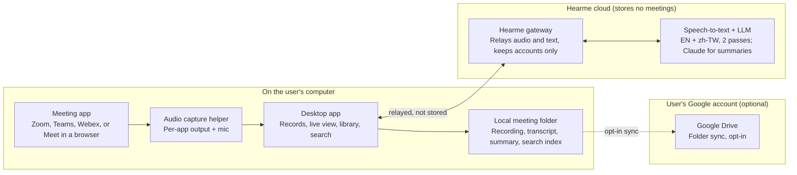

# Hearme — Development Plan

Last updated 2026-10-30 · Peggy Hsieh

## Overview and assumptions

Build Hearme, a botless desktop app (macOS + Windows) that captures meeting audio locally and produces a live, speaker-labelled transcript, without ever joining the meeting as a participant. Target: a usable beta in about 16 weeks with a team of 3–4.

**What it does:** the user starts a meeting in Zoom, Google Meet, Teams or Webex; the app detects it, records the meeting to an audio file, transcribes English and Taiwanese Mandarin (zh-TW) in real time, and produces a summary and action items when the call ends.

**Assumptions this plan makes (change any of them and the plan shifts):**

- Users are knowledge workers on laptops, not contact-center agents.

- One capture method must work across all four platforms on day one, so v1 does not depend on any vendor's API approval.

- English and Taiwanese Mandarin are required from day one, including switching between them mid-sentence; Chinese is always shown in Traditional characters.

- The app never joins the meeting, in any version: no bot, no extra attendee, nothing in the participant list. It only listens to audio already playing on the user's computer.

- Recordings, transcripts and summaries are saved only in a local folder on the user's computer. Syncing that folder to the user's own Google Drive is opt-in. Hearme's servers keep no copy of any meeting.

## Languages, recording and transcription

Three capabilities define v1: the app understands English and Taiwanese Mandarin, records every meeting it hears, and turns that recording into a transcript, both live and again after the call.

| Capability          | What the user gets                                                                                                                                                                    | How we build it                                                                                                                                                                                                                                                          |
|---------------------|---------------------------------------------------------------------------------------------------------------------------------------------------------------------------------------|--------------------------------------------------------------------------------------------------------------------------------------------------------------------------------------------------------------------------------------------------------------------------|
| **English + zh-TW** | Either language, or both in one sentence, transcribed without choosing a language first. Chinese appears in Traditional characters with Taiwan wording (軟體 not 软件, 影片 not 视频) | A speech-to-text model that handles language switching (picked in the Phase 0 benchmark). If a vendor returns Simplified Chinese, convert with OpenCC's s2twp profile, which also swaps mainland terms for Taiwan ones. Custom vocabulary for names, products and jargon |
| **Recording**       | An audio file of every meeting, saved even if the internet drops. Click any transcript line to hear that moment                                                                       | The desktop app writes the mic and the meeting audio to disk as two tracks while it captures, plus a mixed file for playback. Stored in a local folder; syncing to the user's Google Drive is opt-in                                                                     |
| **Transcription**   | Live text during the call (under 2 s delay), then a cleaner final version a few minutes after it ends                                                                                 | Two passes: streaming STT for the live view, then the full recording re-run through a batch model for better accuracy, punctuation and speaker labels. The second pass also fills any gaps from network drops                                                            |

Summaries and action items come out in the meeting's main language, or whichever the user picks (繁中 or English). Accuracy is measured with character error rate (CER) for Chinese, since Chinese has no spaces between words, and word error rate (WER) for English, on at least 10 hours of real Taiwanese meetings.

## Audio capture strategy

**Recommendation: capture audio on the user's own computer ("botless") in every version, so the app listens without joining the meeting. Zoom's no-bot stream (RTMS) is an optional v2 upgrade; meeting bots are ruled out.** Local capture is the only method that covers all four platforms the same way, with no vendor approval and no bot in the call.

### Three ways to get meeting audio

| Method                          | How it works                                                    | Coverage                                    | Speaker names                                    | Main drawback                                              |
|---------------------------------|-----------------------------------------------------------------|---------------------------------------------|--------------------------------------------------|------------------------------------------------------------|
| **Local device capture** (v1)   | Desktop app records the mic plus the meeting app's output audio | All four, plus in-person and any other app  | Not built in: "Me" vs "Others", then diarization | Needs OS permissions; separating speakers is harder        |
| **Official platform APIs** (v2) | Platform streams audio/transcripts to your server               | Different API per platform, uneven maturity | Yes, per participant                             | Approval, review and per-platform engineering              |
| **Meeting bot** (ruled out)     | A bot joins the call as a participant                           | All four via one vendor                     | Yes, from platform metadata                      | Joins as a visible participant, which breaks the core rule |

### Platform-by-platform notes

| Platform            | Official real-time route                                                                                                                       | Status for us                                                                                                                                                                                                                                                                                                                 |
|---------------------|------------------------------------------------------------------------------------------------------------------------------------------------|-------------------------------------------------------------------------------------------------------------------------------------------------------------------------------------------------------------------------------------------------------------------------------------------------------------------------------|
| **Zoom**            | [Realtime Media Streams (RTMS)](https://developers.zoom.us/changelog/rtms/june-25-2025/): audio, video and transcripts over WebSockets, no bot | Generally available since June 2025; needs a Marketplace app and Developer Pack credits ([docs](https://developers.zoom.us/docs/rtms/contact-center/))                                                                                                                                                                        |
| **Google Meet**     | Meet Media API for real-time audio                                                                                                             | Still in the Developer Preview Program; real-time media scopes are restricted and may need a security assessment ([forum, Jul 2026](https://discuss.google.dev/t/how-can-a-public-google-meet-add-on-access-real-time-participant-audio-without-a-bot/385365)). The GA Meet REST API only gives transcripts after the meeting |
| **Microsoft Teams** | Application-hosted media bot via Microsoft Graph                                                                                               | Needs the Calls.AccessMedia.All permission and a bot hosted on Windows Server ([Microsoft Learn](https://learn.microsoft.com/en-gb/microsoftteams/platform/bots/calls-and-meetings/calls-meetings-bots-overview)). It joins the call as a bot, so we don't use it; Teams uses local capture only                              |
| **Webex**           | No general raw-audio API for third parties                                                                                                     | Webex's own transcripts are available after the meeting via its [Meeting Transcripts API](https://developer-portal-k.wbx2.com/docs/api/v1/meeting-transcripts); real-time needs local capture or a bot                                                                                                                        |

### Local capture: how it works per OS

- **macOS 14.2+:** Core Audio process taps capture the output of a specific app (Zoom, Teams, Webex, or the browser running Meet) without a virtual audio driver. The app must declare `NSAudioCaptureUsageDescription` and the user grants system-audio permission ([Apple sample](https://developer.apple.com/documentation/coreaudio/capturing-system-audio-with-core-audio-taps)).

- **Windows 10/11:** WASAPI process loopback captures one process's output.

- **Microphone:** captured as a separate track, so the user's own words are always labelled "Me" correctly.

- **Meeting detection:** watch for running meeting processes and active audio sessions, plus browser tab titles for Meet; prompt "Start transcribing?" rather than recording silently.

**Buy vs build:** [Recall.ai](https://www.recall.ai/blog/new-recall-ai-pricing-for-2026) sells a Desktop Recording SDK that records without joining the call, at \$0.50 per recording hour (transcription +\$0.15/hr). It can shortcut v1 by a few weeks, but at scale that cost per hour adds up, so plan to own the capture layer.

## System architecture

The desktop app captures and cleans audio locally, then saves every meeting in a local folder. The cloud gateway only relays audio and text to the speech-to-text and summary vendors and stores nothing.

The capture helper is the hard, platform-specific part; the local meeting folder (highlighted) is the only place a meeting is kept, and Google Drive sync (dashed) is opt-in and runs directly from the computer.

## Tech stack

Use a thin cross-platform desktop shell with small native audio helpers, a streaming backend, and a pluggable speech-to-text (STT) layer so the vendor can be swapped without touching the app.

| Layer                      | Choice                                                                                                                                                                                                | Why                                                                                                                                   |
|----------------------------|-------------------------------------------------------------------------------------------------------------------------------------------------------------------------------------------------------|---------------------------------------------------------------------------------------------------------------------------------------|
| Desktop shell              | Tauri 2 (Rust) + React/TypeScript UI                                                                                                                                                                  | Small install size, low memory while running beside a video call; Electron is the fallback if the team is JS-only                     |
| macOS audio helper         | Swift, Core Audio process taps + AVAudioEngine for mic                                                                                                                                                | Per-app capture without a virtual driver                                                                                              |
| Windows audio helper       | Rust or C++, WASAPI process loopback + mic                                                                                                                                                            | Same per-app model as macOS                                                                                                           |
| On-device processing       | Echo cancellation, voice activity detection (Silero VAD), Opus encoding                                                                                                                               | Sends only speech, cuts bandwidth and STT cost                                                                                        |
| Local storage              | One folder per meeting (recording, transcript, summary) + a SQLite full-text index                                                                                                                    | The folder is the source of truth; the index can be rebuilt from it                                                                   |
| Google Drive sync (opt-in) | Google Drive API with the drive.file scope, straight from the desktop app                                                                                                                             | Hearme only touches files it created; sync never passes through Hearme's servers                                                      |
| Streaming gateway          | Node.js WebSocket service                                                                                                                                                                             | Relays audio to STT and text to the LLM; stores no meeting content                                                                    |
| STT (cloud)                | Adapter interface; pilot [Soniox](https://soniox.com/speech-to-text/features/language-detection), [AssemblyAI Universal-3.5 Pro Realtime](https://www.assemblyai.com/llms/models.md), Deepgram Nova-3 | All three stream with diarization; Soniox and AssemblyAI handle Mandarin–English code-switching. Pick by a zh-TW benchmark in Phase 0 |
| STT (local-only mode)      | whisper.cpp / faster-whisper on device                                                                                                                                                                | Privacy mode, offline use; transcript arrives slower                                                                                  |
| Summaries & action items   | LLM API (e.g. Claude) via the gateway                                                                                                                                                                 | Runs once at meeting end plus on demand; result saved locally                                                                         |
| Server data                | PostgreSQL for accounts and usage only                                                                                                                                                                | Quotas and billing; no recordings, transcripts or summaries                                                                           |
| Auth & calendar            | Google and Microsoft OAuth; Calendar read access                                                                                                                                                      | Sign-in plus meeting titles and attendee names for speaker labels                                                                     |
| Infra & ops                | Docker, a managed cloud (GCP/AWS, Tokyo or Taiwan region), Sentry, OpenTelemetry                                                                                                                      | Low latency from Taiwan; crash and latency tracking with content scrubbed                                                             |

## Core features

The MVP is: detect the meeting, transcribe it live, summarise it after, and let the user find it again. Everything else waits.

| Feature                                                                         | Release | Notes                                                                 |
|---------------------------------------------------------------------------------|---------|-----------------------------------------------------------------------|
| Meeting detection + one-click start                                             | MVP     | Detects Zoom, Teams, Webex apps and Meet in Chrome/Edge               |
| Live transcript window                                                          | MVP     | Floating panel, under 2 s delay, "Me" vs other speakers               |
| Speaker diarization                                                             | MVP     | Speaker 1, 2, 3 labels the user can rename                            |
| Post-meeting summary + action items                                             | MVP     | Generated within 1 minute of the call ending                          |
| Local library + full-text search + opt-in Google Drive sync                     | MVP     | In the desktop app, searched on the device                            |
| Recording with click-to-play from any line; export audio, Markdown, .docx, .srt | MVP     |                                                                       |
| Recording consent notice                                                        | MVP     | Reminder to tell participants; optional auto-message to paste in chat |
| Calendar integration                                                            | v1.1    | Meeting titles, attendee names to suggest speaker labels              |
| Local-only mode                                                                 | v1.1    | On-device STT, nothing leaves the computer                            |
| Ask questions about a meeting                                                   | v1.1    | Chat over one transcript or across meetings                           |
| Sharing + team workspaces                                                       | v2      | Through the user's own Google Drive sharing                           |
| Zoom RTMS integration (no bot)                                                  | v2      | True per-participant names, admin-installed                           |
| Integrations out (Notion, Slack, Google Docs)                                   | v2      | Push summaries automatically                                          |
| Live translation (zh-TW ↔ EN)                                                   | v2      | Subtitles during the meeting                                          |
| Browser extension (captures the Meet tab's audio)                               | v3      | For users who can't install a desktop app                             |
| Mobile app for in-person meetings                                               | v3      |                                                                       |

## Roadmap

Six phases take the app from spikes to a private beta in week 16 and a public v1.1 by week 22, with platform integrations after that.

| Phase | Weeks | Focus | Gate |
| --- | --- | --- | --- |
| 0: Spikes | 1–2 | Capture spike on macOS and Windows, benchmark 3 STT vendors, 10 user interviews | STT vendor chosen |
| 1: Capture core | 3–6 | Swift and WASAPI helpers, meeting detection for 4 apps, streaming gateway + STT | Live text in all 4 apps |
| 2: MVP | 7–12 | Recording + live transcript, diarization and speaker renaming, summaries, library, search | MVP feature-complete |
| 3: Private beta | 13–16 | 30–50 beta users in Taiwan, signed installers and updates, consent flow, legal review | Error rate under 10%, stable |
| 4: Public v1.1 | 17–22 | Calendar, local-only mode, billing and free tier, ask-the-meeting chat | 35% week-4 retention |
| 5: v2 integrations | 23+ | Zoom RTMS stream (no bot), team workspaces, admin and SSO, exports, live translation | First paying teams |

Each phase ends at a gate; the team moves on only when it is met. Phase 0 is short on purpose: the STT benchmark and capture spike can change the stack before any real build starts.

## Privacy, consent and security

Treat consent as a product feature, not a legal footnote: the app always shows it is recording, and it nudges the user to tell participants.

**Recording consent by market** (not legal advice; get a lawyer's review before launch):

- **Taiwan:** one-party consent. Under Article 29 of the Communication Security and Surveillance Act (通訊保障及監察法), a participant may record a conversation they are part of, as long as the purpose is not unlawful ([summary, checked May 2026](https://www.recordinglaw.com/zh-TW/world-laws/world-recording-laws/taiwan-recording-laws/)). Storing transcripts still falls under the Personal Data Protection Act (個資法).

- **US:** varies by state; about a dozen states, including California, require all-party consent.

- **EU/UK:** GDPR applies to transcripts of identifiable people; needs a lawful basis, a DPA with every sub-processor, and EU data residency for enterprise buyers.

- **Employer policies:** many companies ban unapproved recorders, so B2B sales will need an admin console and audit logs.

**Product safeguards (MVP):**

- Visible recording indicator, never hidden capture.

- One-tap consent message the user can paste into the meeting chat.

- Recordings, transcripts and summaries stay in a local folder; syncing to the user's Google Drive is opt-in, and auto-delete after 30, 90 or 365 days is a setting.

- Per-meeting delete, and full account deletion within 30 days.

- Audio and text pass through Hearme's gateway only on the way to the STT and LLM vendors, and nothing is stored there. No customer data used to train models; STT and LLM vendors on zero-retention terms.

**Security baseline:**

- TLS for every stream; onboarding checks that disk encryption (FileVault or BitLocker) is on, since meetings live on the computer.

- OAuth sign-in only, no passwords stored.

- Signed and notarised desktop builds (Apple notarisation, Windows code signing) with auto-update.

- SOC 2 Type I readiness started in Phase 3 if selling to companies.

## Risks and open decisions

The biggest risk is transcript quality on real Taiwanese meetings (mixed Mandarin and English, laptop mics, people talking over each other), so it is tested first, in Phase 0.

| Risk                                                        | Impact                      | Mitigation                                                                                         |
|-------------------------------------------------------------|-----------------------------|----------------------------------------------------------------------------------------------------|
| zh-TW + English code-switching accuracy is poor             | Core value fails            | Benchmark 3 STT vendors on 10+ hours of real meetings in Phase 0; custom vocabulary per user       |
| Echo: the mic picks up speaker audio, so words appear twice | Messy transcript            | Echo cancellation, dedupe overlapping segments, recommend headphones                               |
| OS updates break audio capture                              | App stops working overnight | Track macOS/Windows betas, automated capture tests on CI machines, fallback to full-system capture |
| Speaker labels are wrong without platform metadata          | Low trust in summaries      | Easy rename, calendar attendee hints, v2 platform integrations for real names                      |
| Users forget to tell participants                           | Legal and reputation risk   | Consent prompt on every start, chat message template                                               |
| STT + LLM cost per hour exceeds price                       | Negative margins            | Send only voiced audio (VAD), cheaper STT tier for free plan, monthly hour caps                    |
| Platform APIs change or need approval (Zoom RTMS)           | v2 delays                   | v1 works without them; integrations are additive                                                   |
| Corporate IT blocks unapproved installs                     | Slow B2B adoption           | Admin console, SSO, MDM deployment package in v2                                                   |

**Open decisions for the team:**

- Build our own capture layer or start on Recall.ai's Desktop Recording SDK?

- Which STT vendor wins the Phase 0 benchmark?

- Tauri or Electron, based on the team's skills?

- Consumer first (individual subscription) or B2B first (team plan)?

- Is local-only mode in the MVP or v1.1?

## Team, costs and success metrics

A team of 3 engineers plus a part-time designer can ship the beta in about 16 weeks; running cost should land near US\$0.15–0.30 per transcribed meeting hour.

**Team**

| Role                            | Focus                                                   | Load      |
|---------------------------------|---------------------------------------------------------|-----------|
| Desktop / native audio engineer | Swift + Rust/C++ capture helpers, Tauri app, installers | Full-time |
| Backend / speech engineer       | Streaming gateway, STT adapters, diarization, summaries | Full-time |
| Full-stack engineer             | Library, search, Google Drive sync, auth, billing       | Full-time |
| Product designer                | Live transcript UI, onboarding, consent flows           | Part-time |
| Product lead / PM               | Scope, beta users, benchmarks, legal review             | Part-time |

**Unit cost per meeting hour** (approximate; confirm with vendor quotes in Phase 0)

| Item                                           | Estimate (US\$/hr)                                                                                                                 |
|------------------------------------------------|------------------------------------------------------------------------------------------------------------------------------------|
| Streaming STT with diarization                 | 0.10–0.15 ([Soniox](https://soniox.com/compare-stt/soniox-vs-assemblyai/chinese) lists ~0.10–0.12 all-in; premium tiers cost more) |
| LLM summary + action items                     | 0.02–0.10                                                                                                                          |
| Hosting, storage, bandwidth                    | 0.02–0.05                                                                                                                          |
| Optional: Recall.ai SDK instead of own capture | +0.50 ([pricing](https://www.recall.ai/blog/new-recall-ai-pricing-for-2026))                                                       |

**Success metrics for the beta**

| Metric                                                                        | Target           |
|-------------------------------------------------------------------------------|------------------|
| Error rate on mixed zh-TW/English meetings (CER for Chinese, WER for English) | Under 10%        |
| Live transcript delay (p95)                                                   | Under 2 seconds  |
| Summary ready after meeting ends                                              | Under 60 seconds |
| New users who transcribe a meeting in 24 h                                    | 60%              |
| Week-4 retention of active users                                              | 35%              |
| Crash-free sessions                                                           | 99.5%            |

## Sources

- [Zoom RTMS general availability](https://developers.zoom.us/changelog/rtms/june-25-2025/)

- [Zoom RTMS docs](https://developers.zoom.us/docs/rtms/contact-center/)

- [Google Meet Media API discussion, Jul 2026](https://discuss.google.dev/t/how-can-a-public-google-meet-add-on-access-real-time-participant-audio-without-a-bot/385365)

- [Microsoft Teams calls and meetings bots](https://learn.microsoft.com/en-gb/microsoftteams/platform/bots/calls-and-meetings/calls-meetings-bots-overview)

- [Webex Meeting Transcripts API](https://developer-portal-k.wbx2.com/docs/api/v1/meeting-transcripts)

- [Apple: Capturing system audio with Core Audio taps](https://developer.apple.com/documentation/coreaudio/capturing-system-audio-with-core-audio-taps)

- [Recall.ai 2026 pricing](https://www.recall.ai/blog/new-recall-ai-pricing-for-2026)

- [AssemblyAI models reference](https://www.assemblyai.com/llms/models.md)

- [Soniox language detection and code-switching](https://soniox.com/speech-to-text/features/language-detection)

- [Taiwan recording laws](https://www.recordinglaw.com/zh-TW/world-laws/world-recording-laws/taiwan-recording-laws/)
